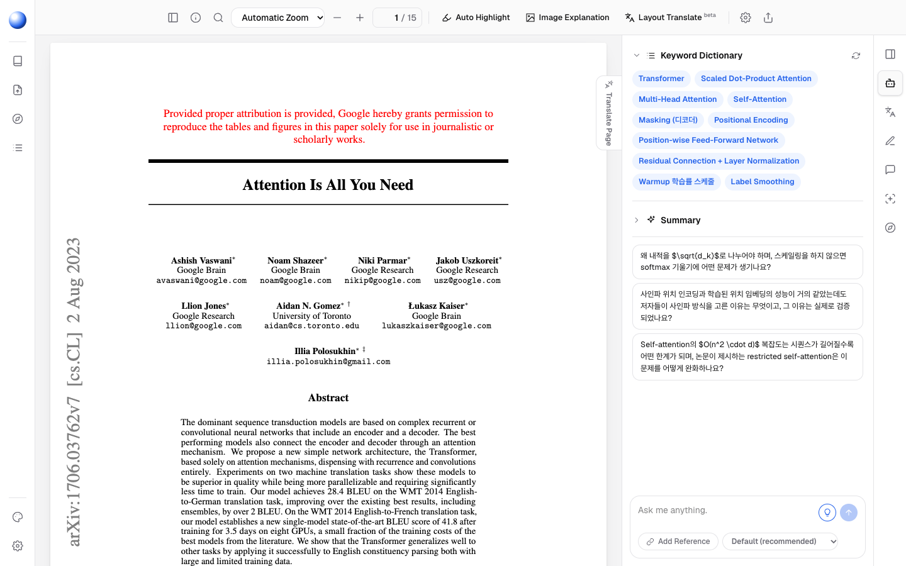

<div align="center">


# Lunaread

**An AI research-paper reader that runs on the subscriptions you already pay for.** Open a PDF or an arXiv ID. An AI colleague beside the page explains passages and figures, translates, finds the key sentences and resolves citations without you leaving the page.

AI runs through the Claude Agent SDK on your Claude login, or through the Codex SDK on your ChatGPT login. You need no API keys and no cloud account. Your papers, highlights and notes stay in your browser.

[**Website**](https://sungmyeonggi.github.io/Lunaread/) · [**Download for Mac**](https://github.com/SUNGMYEONGGI/Lunaread/releases/latest/download/Lunaread-arm64.dmg) · [**Download for Windows**](https://github.com/SUNGMYEONGGI/Lunaread/releases/latest/download/Lunaread-Setup-x64.exe) · [**Open the reader**](https://sungmyeonggi.github.io/Lunaread/library/) · [**Quick start**](#quick-start) · [**Features**](#features) · [**Architecture**](#architecture) · [**Security model**](#security-model) · [**Build and release**](#build-and-release)

[](https://github.com/SUNGMYEONGGI/Lunaread/actions/workflows/release.yml)
[](https://github.com/SUNGMYEONGGI/Lunaread/releases/latest)
[](https://github.com/SUNGMYEONGGI/Lunaread/actions/workflows/deploy.yml)




</div>

> **Alpha, and a personal project.** Lunaread is early. It has only been tested by hand. Expect rough edges, and read the [Security model](#security-model) and [Limitations](#limitations) sections before relying on it.

> **Your subscriptions, your machine.** AI calls go through the Claude Code and Codex logins on this computer, via a small server that listens only on `127.0.0.1`. Lunaread never asks for your password. Papers live in IndexedDB and settings in `localStorage`, both in your browser.

> **Answers in your language.** The interface is in English. AI answers default to Korean; change the language in Settings.

## What it is

A PDF reader with an AI panel, a library and a Semantic Scholar search, delivered three ways:

| Surface | How it runs | AI |
| --- | --- | --- |
| **Website** ([sungmyeonggi.github.io/Lunaread](https://sungmyeonggi.github.io/Lunaread/)) | Static Next.js export on GitHub Pages | Calls the local server at `http://127.0.0.1:8787` when it is running |
| **Local web** (`npm start`) | The same export, served by the local server | Same origin, works out of the box |
| **Desktop app** ([macOS](https://github.com/SUNGMYEONGGI/Lunaread/releases/latest/download/Lunaread-arm64.dmg) · [Windows](https://github.com/SUNGMYEONGGI/Lunaread/releases/latest/download/Lunaread-Setup-x64.exe)) | Electron; starts the server in-process on a free port and opens a window | Works out of the box |

Without the server you can still read papers and add highlights and notes, everything except AI and fetching PDFs by link.

## Built on two agent SDKs

| Provider | Engine | Authenticates with |
| --- | --- | --- |
| `claude-sub` (default) | [Claude Agent SDK](https://docs.claude.com/en/docs/agent-sdk/overview) (`@anthropic-ai/claude-agent-sdk`) | The Claude Code login on this computer (subscription) |
| `codex-sub` | [Codex SDK](https://github.com/openai/codex) (`@openai/codex-sdk`) | The Codex (ChatGPT) login in `~/.codex` |
| `anthropic-api` | Anthropic SDK, Files API with prompt caching | An API key entered in Settings |
| `openai-api` | OpenAI SDK, structured outputs | An API key entered in Settings |

The model list comes from each engine. For Claude, that is the models your plan offers. For Codex, it is `~/.codex/models_cache.json`. Pick a model in Settings or in the chat composer.

## Requirements

- Node.js 22.18 or later. The server runs its `.ts` files directly with Node's type stripping.
- A Claude subscription, signed in with [Claude Code](https://docs.claude.com/en/docs/claude-code) (run `claude`, then log in). Optionally, a ChatGPT subscription signed in with the Codex CLI.
- Optional: `S2_API_KEY` for a higher Semantic Scholar rate limit.

## Quick start

### Desktop app

1. Download the latest release: [**`Lunaread-arm64.dmg`**](https://github.com/SUNGMYEONGGI/Lunaread/releases/latest/download/Lunaread-arm64.dmg) (macOS, Apple Silicon) or [**`Lunaread-Setup-x64.exe`**](https://github.com/SUNGMYEONGGI/Lunaread/releases/latest/download/Lunaread-Setup-x64.exe) (Windows). All builds are on [Releases](https://github.com/SUNGMYEONGGI/Lunaread/releases).
2. **macOS.** Drag **Lunaread** to Applications. The build is signed ad hoc only, so Gatekeeper blocks the first launch. Right-click the app and choose **Open**, or run:

   ```sh
   xattr -dr com.apple.quarantine /Applications/Lunaread.app
   ```

   **Windows.** Run the installer. SmartScreen may warn about an unknown publisher; choose **More info**, then **Run anyway**.
3. The app uses the Claude Code and Codex logins already on this computer. You don't need to configure anything else.

### From source

```sh
git clone https://github.com/SUNGMYEONGGI/Lunaread.git
cd Lunaread
npm install
npm run build
npm start          # http://127.0.0.1:8787
```

You can now use either address:

- **http://127.0.0.1:8787**, served by the local server.
- **The [website](https://sungmyeonggi.github.io/Lunaread/library/).** It finds the server on its own. The first time, Chrome asks for permission to access devices on your local network; choose **Allow**.

To run the desktop app from source, use `npm run desktop`.

## Try it

- On the home screen, paste `1706.03762` and press `Enter`.
- In the chat, press **Summarize with keywords**, then click a suggested question.
- Select a sentence in the PDF and choose **Explain**, **Translate** or **Ask**. The answer appears as a turn in the chat. Or pick a highlight color.
- Turn on **Image Explanation** and drag over a figure. Holding `⌘`/`Ctrl` while dragging does the same.
- Press **Auto Highlight** to mark novelty, method and result sentences.
- Click a citation marker such as `[12]`, or hover an internal link to preview its target.
- Open the palette in the left rail and try any Color Hunt palette as the app theme.

## Main surfaces

| Surface | Purpose |
| --- | --- |
| Landing (`/`, `/features/`, `/pricing/`) | Product site in the style of the Magic UI templates |
| Home (`/library/`) | Chatbot-style start screen: one composer that takes a PDF, an arXiv ID or a link |
| Sidebar | Every paper is a conversation, grouped by Today, Previous 7 days and Older. Also holds New chat, Scholar Deep Search, Library, search and Settings. |
| Library (`/library/?all`) | All papers as cards, with folder filters, folder moves and delete |
| Scholar Deep Search (`/library/?scholar`) | Semantic Scholar search; open-access PDFs go straight into the library |
| Reader (`/read/?id=`) | A chat thread next to the PDF canvas. The PDF toolbar sits on top, the panel rail on the right. Either side can be hidden. |
| Chat thread (AI Colleague) | The paper as an attachment, the keyword dictionary and summary, Auto Highlights, explanation cards as chat turns, Q&A with references and model choice |
| Translate Page tab | Translates the current page as a stream; results are cached per page |
| Markup & Notes tab | Every highlight with its note; export them as Markdown |
| Discussion tab | Strengths, weaknesses and open questions of the paper |
| Settings | Provider and model, server URL and API keys, answer language, theme |

### Keyboard shortcuts

| Keys | Action |
| --- | --- |
| `⌘F` / `Ctrl+F` | Find in paper (`Enter` next, `Shift+Enter` previous) |
| `⌘`/`Ctrl` + drag | Explain the selected area as an image |
| `Esc` | Close popovers, menus and area mode |

## Features

- **Subscription first.** Claude goes through the Agent SDK with `ANTHROPIC_API_KEY` removed from its environment, so it always uses your login instead of API billing. Codex runs in a read-only sandbox.
- **The paper as context.** The full text goes along with every question. On the API providers, the PDF is uploaded once through the Files API and then cached.
- **Explain, translate, ask.** Each selection becomes a card that streams in. A card can also be redrawn as an infographic in your theme's colors.
- **Image Explanation.** The selected region is rendered at full resolution and sent as an image.
- **Auto Highlight.** The model returns verbatim key sentences, which are then located in the text layer and highlighted by category.
- **Layout Translate (beta).** Text blocks are translated and laid over the page in place. Results are cached per page.
- **Smart Citations.** A citation marker is resolved against the paper's reference list. Results are cached per paper.
- **Link preview.** Hovering an internal link renders the destination area of the target page.
- **Library.** Import by arXiv ID, PDF link or drag and drop. Organize papers in folders, search them, and see your reading position.
- **Themes from Color Hunt.** Infinite scroll through every palette, with a live preview, plus light and dark mode.
- **Desktop app.** Electron with a hidden-inset title bar on macOS. External links open in the system browser.

## Security model

- **Loopback only.** The server binds to `127.0.0.1`; set `HOST` to change that.
- **Origin allowlist.** `/api/*` accepts requests from the server's own loopback origin, `https://sungmyeonggi.github.io` and `localhost:3000`. Add more with `LUNAREAD_ORIGINS` (comma-separated). Other origins get `403`, because a request here spends your subscription.
- **DNS rebinding guard.** A request counts as same-origin only when its `Host` is `127.0.0.1` or `localhost`.
- **Private Network Access.** Preflights are answered with `access-control-allow-private-network`, and the browser still asks you before a public page may reach `127.0.0.1`.
- **No SSRF through the PDF proxy.** `/api/pdf` fetches only `http(s)` URLs on public hosts. Loopback, private ranges, link-local and ULA addresses are refused.
- **Your Claude setup stays out.** Agent SDK calls run with `settingSources: []`, `tools: []` and one turn, so your `~/.claude` hooks, `CLAUDE.md` and plugins never apply.
- **Keys stay in the browser.** API keys live in `localStorage`, are sent only to your own server, and are never written to disk by it.
- **Request size cap.** Bodies over 60 MB are refused.

## Configuration

| Variable | Default | Purpose |
| --- | --- | --- |
| `PORT` | `8787` | Server port |
| `HOST` | `127.0.0.1` | Bind address |
| `LUNAREAD_ORIGINS` | none | Extra allowed origins |
| `S2_API_KEY` | none | Semantic Scholar API key |
| `ANTHROPIC_API_KEY`, `OPENAI_API_KEY` | none | Fallback keys for the API providers |
| `CODEX_HOME` | `~/.codex` | Where to read the Codex login and model cache |
| `NEXT_PUBLIC_BASE_PATH` | none | Base path for the static export (`/Lunaread` on Pages) |
| `NEXT_PUBLIC_API_BASE` | same origin | Server address baked into the export |

In the browser, the IndexedDB database `lunaread` holds papers, PDFs, highlights, notes, chats and AI caches. The `localStorage` key `settings` holds settings.

## Architecture

```
┌──────────────────────── Browser / Electron window ────────────────────────┐
│  Next.js static export (out/)                                             │
│   app/            /, /features, /pricing, /library, /read                 │
│   components/site Landing, nav, mocks (Magic UI-style effects in CSS)     │
│   components/app  Library, Rail, Settings, ThemePicker, GetStarted        │
│   components/viewer Viewer, PdfPage (pdf.js), Panels                      │
│   lib/            api, db (IndexedDB), pdf, layout, theme, types          │
└───────────────────────────────▲───────────────────────────────────────────┘
                                │ fetch / SSE   (same origin, or CORS + PNA)
┌───────────────────────────────┴──── server/server.ts (127.0.0.1:8787) ────┐
│  /api/ai (SSE) · /api/ai-json · /api/upload · /api/models                 │
│  /api/pdf · /api/scholar · /api/palettes · /api/health · static out/      │
│     └── providers.ts ── Claude Agent SDK │ Codex SDK │ Anthropic │ OpenAI │
│     └── prompts.ts ──── task prompts and JSON schemas                     │
└───────────────────────────────────────────────────────────────────────────┘
```

| Path | Purpose |
| --- | --- |
| `app/` | Next.js App Router pages. Library and reader are client-only. |
| `components/site/` | Landing, features and pricing: nav, hero, bento, feature switcher, FAQ |
| `components/magic/` | BlurFade, BorderBeam, Marquee, ShinyText (CSS, no motion library) |
| `components/app/` | Library, rail, settings, the model picker, Color Hunt theme picker, Get started dialog |
| `components/viewer/` | Reader: zoom, search, selection, citations, link previews, area capture, panels |
| `lib/` | Typed client: API client, IndexedDB store, pdf.js helpers, layout and theme math |
| `server/` | Node server, AI providers, prompts and schemas |
| `electron/main.cjs` | Desktop shell; imports the compiled `dist-server/server.js` |
| `lib/*.test.ts` | Unit tests for layout block grouping and theme derivation |

## Build and release

```sh
npm run typecheck    # tsc for the app and the server
npm test             # node --test lib/*.test.ts
npm run build        # next build (out/) + tsc server (dist-server/)
npm run build:pages  # export with basePath /Lunaread for GitHub Pages
npm run dev          # server + next dev at http://localhost:3000
npm run desktop      # build, then Electron
npm run dist:mac     # dist/Lunaread-arm64.dmg
npm run dist:win     # dist/Lunaread-Setup-x64.exe
```

| Item | Value |
| --- | --- |
| App ID | `io.lunaread.app` |
| Targets | macOS `dmg` (arm64), Windows `nsis` (x64) |
| Icon | `build/icon.png`, rendered from `build/icon.svg` |
| Packaged files | `out/**`, `dist-server/**`, `electron/**`, `package.json`, and the runtime `dependencies`, which include the Claude Code and Codex binaries for the platform |
| Signing | Ad hoc on macOS (`identity: "-"`). Windows builds are unsigned. |

### Releasing

Releases are continuous. Every push to `main` that changes more than Markdown or `docs/` runs `.github/workflows/release.yml`:

1. Builds on `macos-14` and `windows-latest` in parallel. Each job sets the version to `<major>.<minor>.<run number>`, runs the typecheck and the tests, and packages the installer.
2. Publishes both files as GitHub Release `v<version>`, with notes generated from the commits, and marks it latest.

The download links on the website and in this README point to `releases/latest/download/…`, so they always serve the newest build. To start a new minor line, change `version` in `package.json`.

### Website

Every push to `main` also runs `.github/workflows/deploy.yml`. It runs `npm run build:pages` and deploys `out/` to GitHub Pages at <https://sungmyeonggi.github.io/Lunaread/>.

## Limitations

- On the website, AI features need the local server, plus the browser's permission to reach it.
- Only one person, one browser. There is no sync between devices.
- Scanned PDFs without a text layer get no selection actions, search or Auto Highlight.
- Desktop builds are not notarized or code-signed. macOS ships for Apple Silicon only, Windows for x64 only.
- The interface is in English only.

## Roadmap

- [ ] OCR for scanned PDFs
- [ ] Signed and notarized desktop builds, with auto-update
- [ ] Intel Mac and Linux builds
- [ ] Export and import of the library
- [ ] Sync across devices

## Acknowledgements

- Lunaread is an independent project. It is not affiliated with or endorsed by Anthropic, OpenAI or Moonlight.
- Design inspired by the [Magic UI](https://magicui.design) templates.
- Palettes from [Color Hunt](https://colorhunt.co), paper search from [Semantic Scholar](https://www.semanticscholar.org), PDF rendering by [pdf.js](https://mozilla.github.io/pdf.js/).
- Brand logos identify their services only.

## Contributing

- Open an issue before starting substantial work.
- Keep changes focused, and update this README when setup, behavior or security changes.
- Keep secrets, keys and paper data out of the repository.
- Run `npm run typecheck` and `npm test` before opening a pull request.
